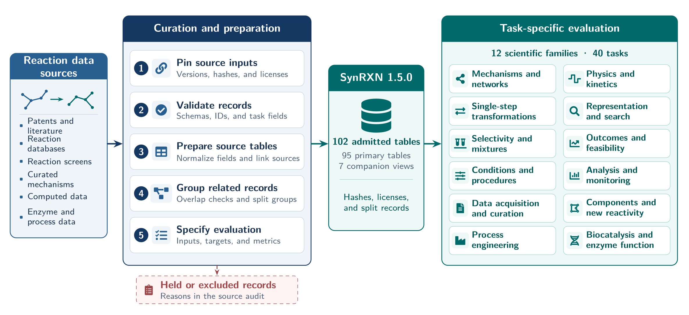

# SynRXN

<p align="center">
  
</p>

[](https://pypi.org/project/synrxn/)
[](https://github.com/tieulongphan/synrxn/actions/workflows/test-and-lint.yml)
[](https://doi.org/10.5281/zenodo.17297258)

SynRXN links reaction datasets to evaluation tasks and records the sources,
targets, metrics, and splits. Model comparisons for the expanded catalog
are pending.

[](doc/figure/synrxn-workflow-1.5.0.png)

[LaTeX source](doc/figure/synrxn-workflow-1.5.0.tex) ·
[Task-by-task atlas](doc/figure/evaluation-atlas-1.5.0.png) ·
[Download the 102 tables](Data/releases/1.5.0/)

## Installation

Use Python 3.11 or later. From this checkout:

```bash
pip install -e ".[query]"  # includes DuckDB and PyArrow
```

This branch contains the 1.5.0 release candidate. `pip install synrxn`
installs the published PyPI version. Optional extras include `dev`, `docs`,
`expansion`, and `service`. The author checkout stores the chemistry backend
under `archive/releases/candidate/software/`.

For published CSV/Parquet releases, see [Installation and first analysis](doc/getting_started.rst).

## Database

The main database holds **95 primary tables** and **seven companion views**
for earlier source formats, named subsets, and mechanism checks. The
Diels–Alder entry contains metadata. The full DuckDB deposit on Zenodo
is pending.

The evaluation views pair the same observations across input variants and named
subsets. Use the enriched SNAr and cycloaddition tables for the primary energy
records, the full Catechol panel for product distributions and sequential
selection, and the separate NatComm and Golden-only panels for atom mapping.
[Scoring records and splits](doc/query_and_service.rst#scoring-records-and-splits)

The two FREA tables are available separately from the upstream
[expert benchmark](https://huggingface.co/datasets/FREA-benchmark/FREA-benchmark)
and [training corpus](https://huggingface.co/datasets/FREA-benchmark/FREA-corpus).
The original table files total **1.01 GiB**. The DuckDB database also embeds
native source files. It occupies **11.44 GB** as a database and **7.63 GB**
as a Zstandard archive.

```python
from pathlib import Path
import duckdb

with duckdb.connect(str(Path("synrxn.duckdb").resolve(strict=True)), read_only=True) as db:
    name = db.execute("""
        SELECT view_name FROM catalog.dataset_tables
        WHERE namespace = ? AND table_key = ? AND release_admitted
    """, ["canonical", "yield/hitea"]).fetchone()[0]
    print(db.table("data." + name).project(
        "sample_id, reaction_smiles, yield_pct, yield_measurement_type"
    ).limit(5).fetchall())
```

`catalog.*` describes sources and task membership, `data.*` stores source rows,
and `assets.chunks` stores compressed native files and notices. Several tasks can
share one table. Row counts retain their source units and can overlap.

Follow [Database access](doc/query_and_service.rst) for file locations, checksum
verification, task queries, types, terms and native-file extraction.
[Data model and reconstruction](doc/data_concept.rst) explains the source folders
and `storage build --materialize`. Use `--scope catalogue` to build the full local
catalog with FREA. Building requires the matching source files. Open an
existing database directly with DuckDB. DataLoader and the current HTTP
service use the earlier CSV and Parquet catalog.

## Repository

| Location | Contents |
|---|---|
| [synrxn/reconstruction/](synrxn/reconstruction/) | Source acquisition, table preparation, task hierarchy, and storage |
| [synrxn/metrics/](synrxn/metrics/) | Metric profiles and chemistry evaluators |
| [synrxn/split/](synrxn/split/) | Split protocols, grouping constraints and repeated folds |
| [synrxn/benchmarks/](synrxn/benchmarks/) | Tasks, reference data, eligibility, and evaluation views |
| [synrxn/data/](synrxn/data/) | Loading, catalog metadata, manifests, and release checks |
| [synrxn/access/](synrxn/access/) | Queries, access measurements and the optional service |
| [Data/families/](Data/families/) | Prepared tables organized by family and task. Tasks that share a table link to one file. |
| [Data/metadata/](Data/metadata/) | Source URLs, checksums, licenses, task definitions and split assignments |
| [doc/](doc/) | Data access, evaluation methods, source records, and API documentation |
| `archive/` (local, ignored) | Native downloads in `datasets/raw/`, held data, and historical sources |

The preparation scripts read the pinned inputs in `archive/datasets/raw/`
and write verified tables to `Data/families/`. The NMR preparation, for
example, produces 3,022 spectrum records in three tables. It computes
integral targets from the spectra.

## Development checks

Install the development dependencies with `pip install -e ".[all,dev]"`, then run:

```bash
scripts/pytest.sh
scripts/lint.sh
# Select a subset when working on one component:
scripts/pytest.sh -q Test/io Test/reconstruction/expansion
scripts/lint.sh scripts Test/io Test/reconstruction/expansion
```

Run `python scripts/check_release.py` to check candidate version consistency,
and pass `--dist-dir PATH` to inspect built wheels and source distributions.
See the [1.5.0 release notes](doc/whats_new.rst) for the data scope and deposit status. The database guide also covers
the [compact build and scoring views](doc/query_and_service.rst).

Both launchers accept `PYTHON=/path/to/python` and work from any directory.
`Test/` follows the Python package directories. Pytest uses importlib mode
to allow repeated test filenames.
Lint checks the layout, Python file sizes, Sphinx docstring fields and flake8.
Use Sphinx fields (`:param name:`, `:type name:`, `:return:`, `:rtype:` and
`:raises Exception:`) in docstrings. Keep examples in reStructuredText code
blocks.
Its conventions follow [SynKit's scripts](https://github.com/TieuLongPhan/SynKit/tree/4830aa2d1609b4c6522c0e6f3eaa0918c28d9c2f/scripts).
The full suite requires local source files and the chemistry backend. Two
modules have existing limits in `pyproject.toml`. Other files are limited
to 1,000 lines excluding docstrings.

## Reproduction and evaluation

```bash
python -m synrxn.reconstruction families list
python -m synrxn.reconstruction families plan --family outcomes
python -m synrxn.reconstruction families build --family outcomes --check-rows --output .cache/synrxn/runs/outcomes-001
python -m synrxn.reconstruction families verify --all --check-rows --output .cache/synrxn/runs/verify-001
python -m synrxn.reconstruction families organize
python -m synrxn.benchmarks.protocols --output .cache/synrxn/task-protocols.json
```

Construction regenerates supported native views and verifies pinned canonical
inputs. All 40 release tasks have metric profiles and split protocols.
Check each source's targets, units, and split groups before evaluation.
See [task evaluation](doc/task_evaluation.rst) and
[reconstruction and storage](doc/data_concept.rst).

## Documentation and citation

[Online documentation](https://synrxn.readthedocs.io/en/latest/) ·
[References and citation](doc/reference.rst) ·
[Issues](https://github.com/tieulongphan/synrxn/issues)

Phan, T.-L., Nguyen Song, N.-N., and Stadler, P. F. *SynRXN: An Open Benchmark and
Curated Dataset for Computational Reaction Modeling.* Scientific Data **13**, 625
(2026). [Article](https://doi.org/10.1038/s41597-026-07260-w).
Cite the archived software version and the exact data version used in your
analysis. The [SynRXN software archive](https://doi.org/10.5281/zenodo.17297258)
lists the existing GitHub releases. The 1.5.0 dataset deposit is pending.
BibTeX is available in [the reference page](doc/reference.rst).

The source code uses [Apache 2.0](LICENSE). Dataset terms differ by source and
redistribution partition. See the [data license notice](Data/metadata/LICENSE) and the
[release manifest](Data/metadata/reconstruction/coverage/release_manifest.json).

This project received funding from the European Union’s Horizon Europe Doctoral
Network programme under Marie Skłodowska-Curie grant No. 101072930
([TACsy](https://tacsy.eu/)).
